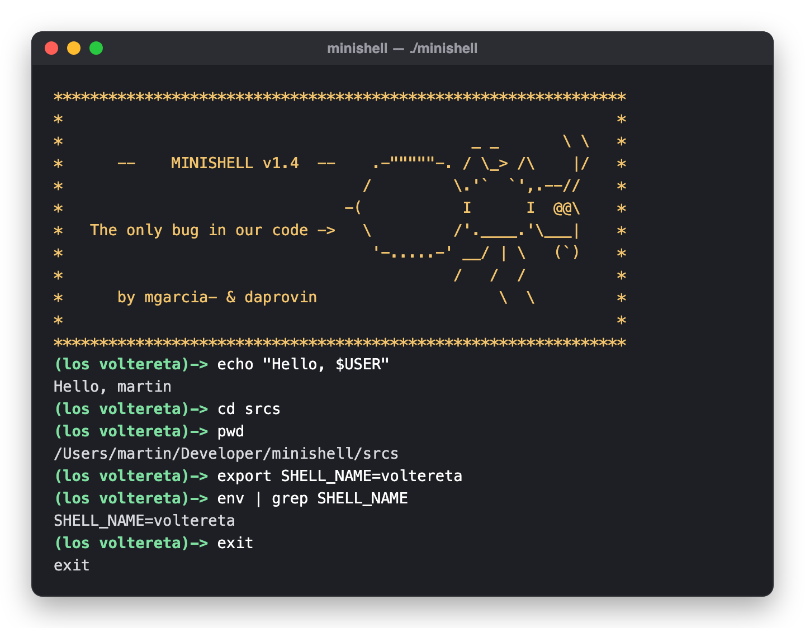
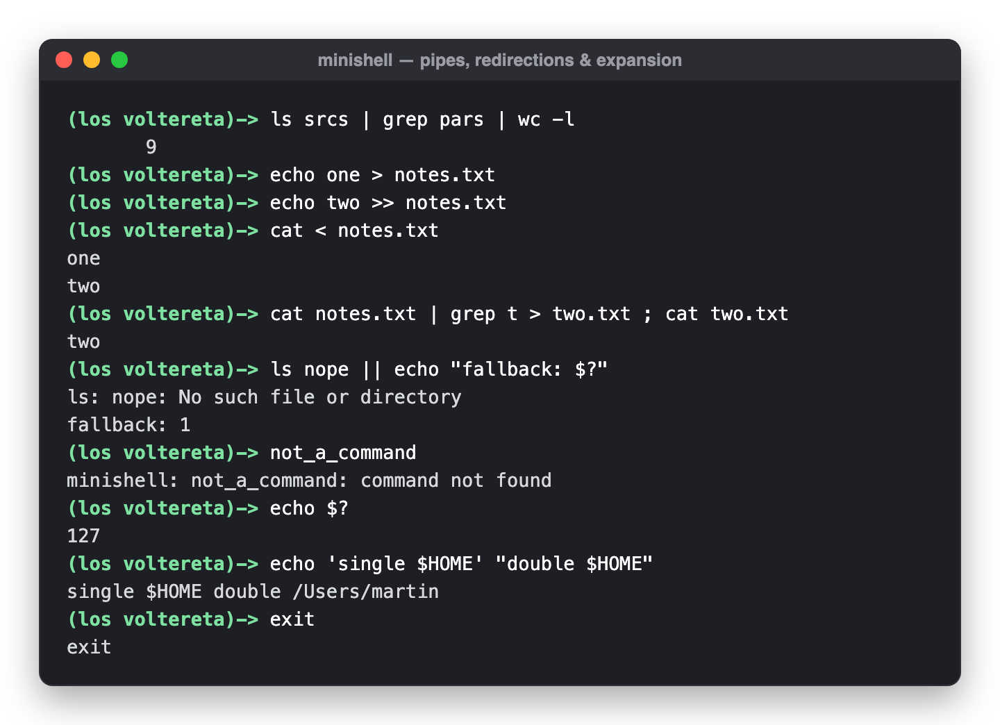

<h1 align="center">minishell</h1>

<p align="center">
  A small bash-like shell written in C, from scratch — <a href="https://42.fr">42cursus</a> project by <b>los voltereta</b>.
</p>

<p align="center">
   prompt" />
</p>

minishell reads a command line, tokenizes it, builds a command tree and runs it with `fork`, `execve`, `pipe` and `dup2` — no `readline`, no parser generators, only the C standard library, POSIX system calls and our own [libft](libft).

## Features

- **Builtins**: `echo` (with `-n`), `cd`, `pwd`, `export`, `unset`, `env`, `exit`
- **External commands**, resolved through `PATH` (or given as a relative / absolute path) and run with `execve`
- **Pipes** `|`, chained as long as you like
- **Redirections** `<`, `>`, `>>`, wherever they appear in the command (`> out echo hi` works too)
- **Command lists** `;`, `&&`, `||`
- **Quotes and escaping**: `'single'`, `"double"` and `\`
- **Expansion** of environment variables (`$HOME`) and of the last exit status (`$?`)
- **Signals** like bash: `Ctrl-C` gives you a fresh prompt, `Ctrl-\` is ignored, `Ctrl-D` exits
- **Non-interactive mode**: `./minishell -c "<command>"`
- **Exit codes and error messages that match bash**, on both macOS and Linux (the Makefile sets the syntax-error and `exit` error codes per OS)

<p align="center">
   and >> redirections, ||, $? and quoting" />
</p>

## How it works

```
 input line
     │
     ▼
 lexer ──► token list ──► syntax check ──► split on ; && || ──► expand $VAR and $? ──► command tree ──► execute
```

1. **Lexing** — the line becomes a list of typed tokens: literals, quotes, `$` variables, `|`, `<`, `>`, `>>`, `;`, `&&`, `||`…
2. **Cleaning up** — quoted text is joined into single words, whitespace tokens are dropped, redirections are moved into a canonical position and the syntax is checked (errors are reported like bash: `syntax error near unexpected token`).
3. **Splitting** — the list is cut on `;`, `&&` and `||`; each part runs in turn, and when `&&` or `||` short-circuits on `$?`, the rest of the line is skipped.
4. **Tree building** — pipes and redirections become inner nodes and commands become leaves. Each new operator becomes the root, with everything before it as its left child, so `ls | grep a > out` turns into:

   ```
            >
           / \
          |   out
         / \
       ls   grep a
   ```

5. **Execution** — the tree is walked recursively: a pipe node forks one process per side and connects them with `pipe`, a redirection node opens its file and `dup2`s it onto stdin or stdout, and a leaf runs a builtin in place or `fork` + `execve`s the program.

## Build and run

```sh
git clone https://github.com/martingarcialopez/minishell
cd minishell
make
./minishell
```

Or run a single command line and exit:

```sh
./minishell -c 'echo hello | cat'
```

`make clean` removes the object files, `make fclean` also removes the binary and `libft.a`, and `make re` rebuilds everything.

> [!NOTE]
> **Apple Silicon:** minishell was written in 2020 for Intel Macs and Linux. Our `ft_printf` hands its `va_list` to helper functions by value, which only works where `va_list` is an array type (x86_64). On arm64 it builds, but formatted output repeats its first argument. Build an x86_64 binary and run it under Rosetta instead:
>
> ```sh
> make -C libft CC="gcc -g -arch x86_64"
> make CFLAGS="-Wall -Wextra -Werror -arch x86_64 -D SYNTAX_ERROR=2 -D EXIT_ERROR=255"
> ```

## Testing

We tested minishell against bash with [**minishell_unit_test**](https://github.com/martingarcialopez/minishell_unit_test). It runs over a hundred command lines through both shells with `-c` and compares stdout, stderr and the exit code. Clone it at the root of this repository and run `./unit_test.sh`.

## Project layout

```
.
├── Makefile
├── includes/        # tree.h (tokens, command tree), builtins.h (environment, builtins)
├── srcs/            # lexer, parser, tree building, execution, builtins
├── libft/           # our C library: libft + ft_printf + get_next_line
└── fnct_names/      # each author's list of source files, read by the Makefile
```

## Authors

- **Martín García López** — [@martingarcialopez](https://github.com/martingarcialopez) (mgarcia-)
- **David** — [@42daprovin](https://github.com/42daprovin) (daprovin)
